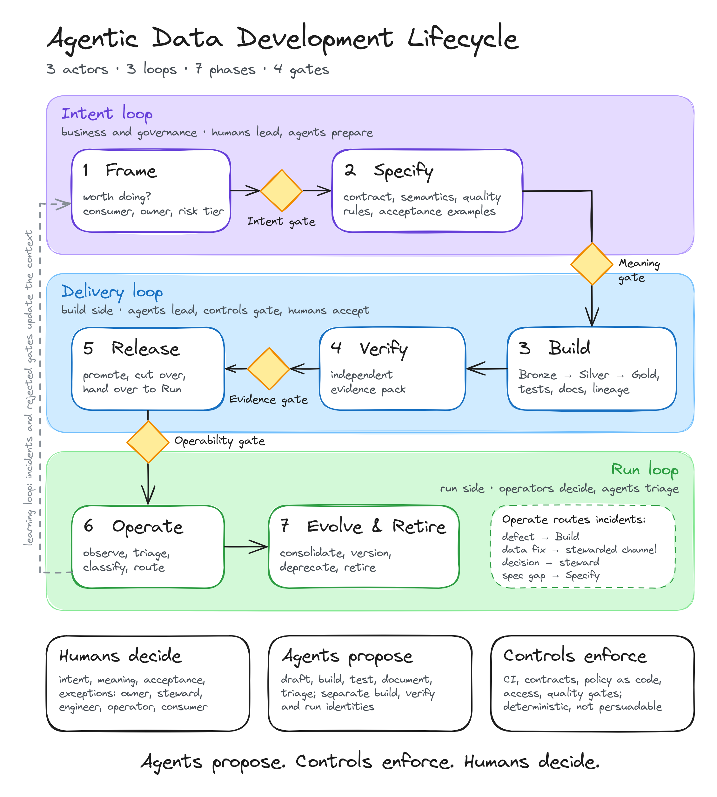

# ADDLC - The Agentic Data Development Lifecycle

**An open, vendor-neutral lifecycle for data teams working with AI agents: who decides, what gets verified and how autonomy is earned.**

Agents made data pipelines cheap. Being wrong is still expensive. ADDLC is a lifecycle designed around that shift:

> **Agents propose. Controls enforce. Humans decide.**

- **3 actors** - humans (decide), agents (propose), controls (enforce)
- **3 loops / 7 phases** - Intent (Frame, Specify), Delivery (Build, Verify, Release), Run (Operate, Evolve & Retire)
- **4 gates** - Intent, Meaning, Evidence, Operability
- **6 autonomy levels** - Manual, Assist, Draft, Supervised, Delegated, Self-organizing - assigned per change class, earned with evidence, lost with escapes



| | |
|---|---|
| Version | **1.0.0**, released 2026-11-10 |
| Specification | [spec/addlc-spec.md](spec/addlc-spec.md) (normative, RFC 2119 keywords) |
| Narrative | [The Agentic Data Development Lifecycle (ADDLC)](https://medium.com/@savvakrasava/agentic-data-development-lifecycle-addlc-d40122a46e2c) on Medium - rationale, prior art, anti-patterns, canon mapping |
| Editor | Savva Lukhnev |

## Repository map

```
spec/
  addlc-spec.md            The normative specification: 67 numbered requirements
                           (RFC 2119), conformance levels, requirement index
  terminology.md           Normative terms and definitions
conformance/
  self-assessment.md       Yes/no questionnaire mapped to requirement IDs
templates/
  intent-brief.md          Frame exit artifact
  gate-intent.md           Gate checklists, one per gate
  gate-meaning.md
  gate-evidence.md
  gate-operability.md
  autonomy-register.md     Change classes, ceilings, levels, promotion/demotion log
  handover-package.md      Build-to-Run handover checklist
  metrics.md               Metric definitions and a reporting table
figures/                   Model diagrams (PNG, SVG, Excalidraw sources)
LICENSES/                  Full license texts
```

## Conformance levels

| Level | Name | In one line |
|---|---|---|
| 1 | Assisted | Agents draft, humans review everything; shared context, agent identities, attribution. |
| 2 | Spec-driven | Spec approved before build; four gates with evidence packs; Build/Run segregated; baseline measured. |
| 3 | Governed autonomy | Autonomy per change class, moved by metrics; run agents triage; context owned and tested. |
| MRD | MRD profile | Mandatory at Level 2+ for scopes with master or reference data: stewarded change channel, hard ceilings, mandatory reconciliation. |

A claim names its scope (a team or domain, not a company) and the exact version: `Conforms to ADDLC v1.0.0, Level 2, MRD profile`. Start with the [self-assessment](conformance/self-assessment.md).

**On the name.** Coalesce used "the agentic data development lifecycle" for a workflow anchored in one product (Dengsøe, October 2026) - credited in the article's prior-art review alongside five other sources. This repository defines the vendor-neutral specification of the lifecycle: decision rights, gate criteria, autonomy policy, metrics and conformance.

## Adopting it

Incremental, roughly 90 days: (1) baseline and inventory, (2) context and agent identities plus the Meaning gate, (3) one change class through all four gates, (4) Operability gate and a promotion decision made from metrics. Details in section 15 of the article. Keep the Meaning gate strict and everything else light at first.

## Contributing

Disagreement backed by practice is the fastest way to improve this. Most wanted: change classes and autonomy ceilings from your domain; gate criteria that worked or failed; metric baselines; where the model breaks (streaming, unstructured data, ML features). See [CONTRIBUTING.md](CONTRIBUTING.md). Material improvements are folded into the next revision, with credit.

## License

- Specification text, terminology and figures: [CC BY 4.0](LICENSES/CC-BY-4.0.txt)
- Templates and checklists: [Apache-2.0](LICENSES/Apache-2.0.txt), so you can copy them into internal regulations without attribution plumbing

See [LICENSE.md](LICENSE.md). Cite via [CITATION.cff](CITATION.cff).
